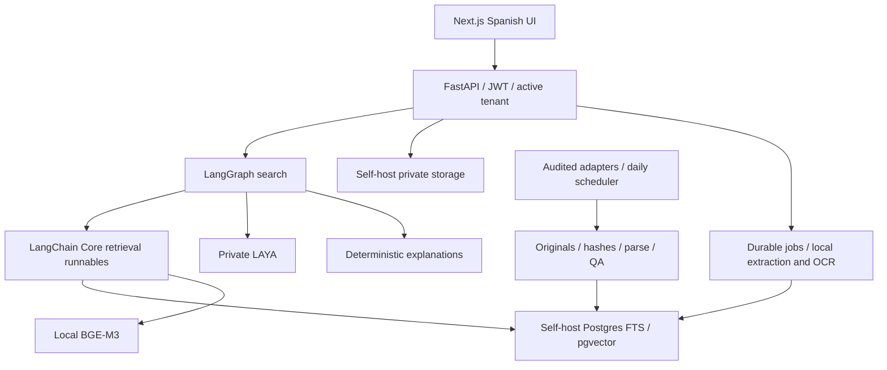

# Architecture

Current authentication/gateway/deployment and detailed workflow diagrams are in [DEVELOPER_GUIDE.md](DEVELOPER_GUIDE.md). Local Supabase Auth, scanner, TLS rehearsal and encrypted snapshots now exist; production acceptance remains open.

Confirmed target. FastAPI, LangChain Core, LangGraph, local LAYA/BGE-M3, PostgreSQL/pgvector, local private storage and Next.js now run in development. Production Supabase/auth/TLS/scanning/backups and nationwide publisher adapters remain incomplete. See LOCAL_OPERATIONS.md and IMPLEMENTATION_PROGRESS.md for observed implementation boundaries.

## Mandatory responsibilities

| Component | Role | Constraint |
|---|---|---|
| FastAPI | Typed routes, verified auth, tenant context, lifecycle/errors. | No client tenant trust or elevated role for user search. |
| LangChain Core | Real runnable/retriever boundaries around local functions. | No chat model, generated query or explanation. |
| LangGraph | Typed workflow, bounded branches, deadlines/cancellation. | No autonomous unbounded agents or private search persistence. |
| LAYA | Fixed labels, shadow metrics, gated ordering. | No applicability/validity/date decisions. |
| BGE-M3 | Local 1024-d embeddings. | Pin artifacts; LAYA is not an embedding model. |

Ordinary Python nodes/function runnables support this non-generative design. [Graph API](https://docs.langchain.com/oss/python/langgraph/graph-api), [Core implementation](https://github.com/langchain-ai/langchain/blob/master/libs/core/langchain_core/runnables/base.py).

## Interfaces

Shared types live in `services/api/app/contracts.py`: `TenantContext`, `SearchRequest`, `SearchResponse`, `RetrievalQuery`, `Candidate`, `Decision`, `Reason`, `CoverageReport`, `DocumentRecord`, `DocumentSelection`, and `ProcessingJob`; fields are defined in the API/data contracts.

- `HybridRetriever.ainvoke(query: RetrievalQuery) -> list[Candidate]`: LangChain Core runnable.
- `LayaClient.classify(query: str, candidates: list[Candidate]) -> list[Decision]`: async private HTTP.
- `build_search_graph(retriever, laya, explainer).ainvoke(state: SearchState) -> SearchState`: compiled LangGraph.
- `SearchService.search(request: SearchRequest, context: TenantContext) -> SearchResponse`: orchestrates one authorized request.

## Search graph

`START -> validate -> resolve_selection -> retrieve -> fuse -> laya_shadow -> explain -> serialize -> END`.

Validate JWT, active membership, territory/date/mode and limits before access. Document mode loads stored authorized spans rather than trusting submitted text. Retrieve exact references/FTS/trigram/embeddings under matching filters; keep public legal retrieval separate from private selections. Fuse with RRF k=60, deterministic ID tie-breaking, grouping and diversity.

LAYA classifies up to 50 nonempty candidates as none/partial/direct; empty candidate lists explicitly skip inference. Shadow decisions do not change ordering. A separately approved flag permits bounded reranking without dropping candidates. LAYA failure yields fused results with warning; auth or selection integrity failure does not use that fallback.

Explain with literal original offsets or verified metadata. Recheck access/deletion epoch before returning document-linked responses. Search graph has **no checkpointer** and no external tracing. Durable ingest/document workflows persist only IDs/cursors/status; content stays in authorized storage. [Persistence behavior](https://docs.langchain.com/oss/python/langgraph/persistence).

## LAYA transport

Use private `laya[serve]`, mandatory bearer secret, full response metadata and a real multilingual decision as readiness. Process health alone is insufficient. HTTP batches use states/shared questions; in-process calls use per-request dictionaries. Validate ordered cardinality, labels, probabilities, abstention and truncation; absent truncation is unknown, not false. [HTTP contract](https://github.com/NandhaKishorM/laya/blob/main/docs/http-api.md).

Initial application policy: total LAYA budget 2 seconds; at most one transient transport/503 retry within budget; five consecutive failures open a shared circuit for 30 seconds with one half-open probe; bounded concurrency. Measure these settings in the pilot. Async HTTP keeps CPU inference off the API event loop. Never log request bodies. Incomplete/truncated decisions cannot affect rank.

## Auth, database, storage and jobs

Verify signature/issuer/audience/expiry/approved algorithms against local auth keys. Resolve `TenantContext(user_id, tenant_id, role)` from verified claims and membership. Non-BYPASSRLS user transactions have trusted identity/active-tenant context; policies require both membership and active tenant. Test multi-membership users and context reset in pools. Separate public corpus writer and private job roles.

Enforce composite document/tenant linkage in private chunks. Use distinct public originals and private client buckets. Download signatures last at most 60 seconds and pass an authorization gateway that can revoke immediately: existing unrevocable signed URLs alone cannot satisfy immediate revocation.

Durable database jobs use leases, bounded retries, idempotency and deletion checks. FastAPI background tasks alone do not guarantee OCR/purge completion. Quarantine uploads until size/type/archive/malware checks pass. SQL reference evolves into versioned migrations.

## Deletion and operation

No automatic age expiry. Deletion writes a tombstone, denies reads/downloads/jobs, cancels processing, invalidates caches/links and queues purge. Live originals/derivatives/text/vectors disappear within 24h; encrypted backup copies expire within 30 days. Restore reapplies tombstones before access. Tombstone lifetime covers usable backups and restore window without document text.

Freeze package/Python versions, image digests, checkpoint revisions/file hashes and license review in F1. Python 3.12 is the initial compatibility-test target, not a tested lock. Smaller source pilots are internal; all coverage/operations gates must pass for launch. LAYA shadow deployment is required even with production reranking disabled.
