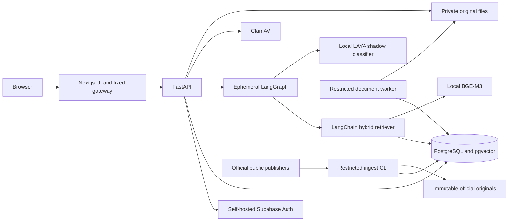
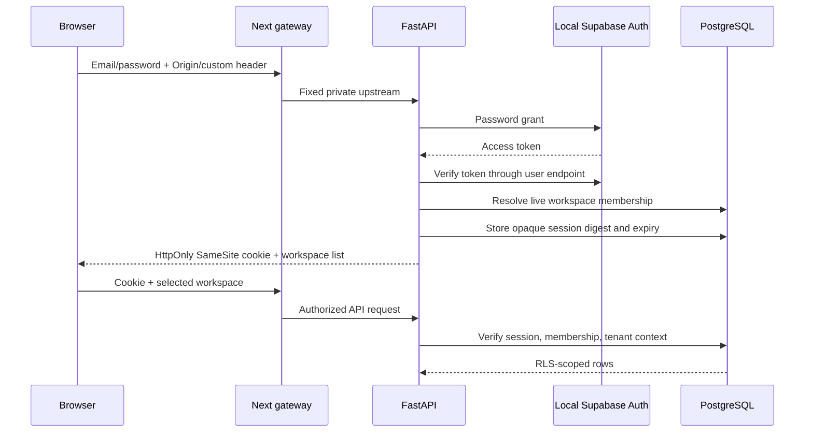
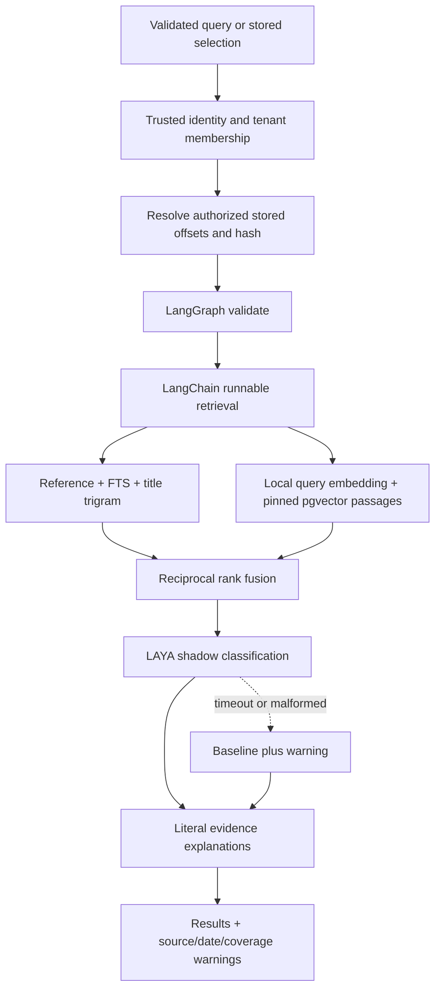
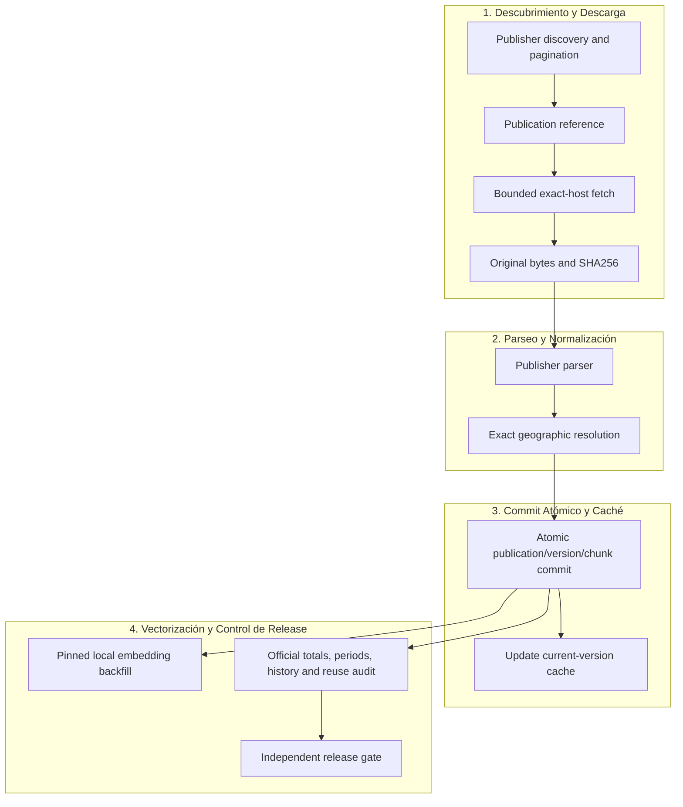
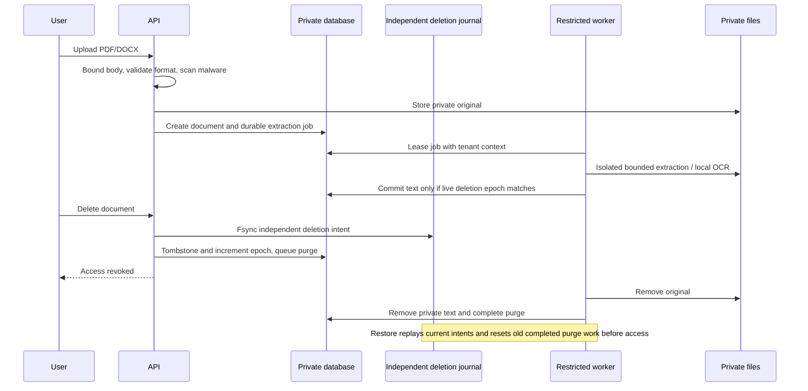

# Developing LAYA Jurídico

The application retrieves official text and classifies relevance without generative LLMs. FastAPI is the authorization/API boundary, LangChain Core supplies runnable interfaces, LangGraph coordinates a transient search, local BGE-M3 embeds queries/passages and real local LAYA classifies candidates in shadow mode. The Next.js UI talks to a fixed same-origin gateway; self-hosted Supabase Auth verifies passwords. PostgreSQL and filesystem storage remain self-hosted.

## Architecture and trust boundaries

The API role can read public legal tables and authorized private rows; ingest cannot read private data; worker has tenant-scoped extraction/purge access. Admin credentials appear only in maintenance tools. FORCE RLS, composite document/tenant foreign keys and trusted transaction-local identity defend the private boundary. The Auth role uses an isolated database and has no legal/private-document grants.

Never introduce an external embedding/classification endpoint, private tracing or a graph checkpointer. Model manifests pin revision plus local file hashes. `trust_remote_code=False` and offline model loading prevent unreviewed remote execution. LAYA classifier output must have zero generated tokens, matching cardinality and validated probabilities/labels; incomplete or failed classification cannot alter baseline ranking.

## Authentication flow

Browser session tokens are random opaque values, stored as hashes in `browser_auth.sessions`. They are never returned in JSON or stored in localStorage. Cookie writes require an approved Origin and `X-Requested-With: LAYA`. Production cookies are Secure. Automation may use RS256 bearer credentials, still requiring live membership. The tenant header selects among authorized workspaces; it does not assert identity.

Password change re-verifies the current credentials, updates local Auth and revokes all browser sessions. Logout deletes the session digest. Browser session expiry has no silent persisted private workflow. The same-origin route streams uploads/downloads and forwards an allowlisted set of headers to a fixed local upstream, avoiding arbitrary proxy destinations.

## Search and version selection

`SearchService` resolves selected document spans before graph execution. The graph is compiled without a checkpointer. Candidate retrieval applies source/territory/type/date/effectiveness filters before LIMIT, fuses independent rank lists and caps repeated passages per version.

The atomic dated current-version cache avoids repeatedly sorting the entire historical corpus for ordinary current searches. It is used only when its date matches the request's current day and no explicit as-of/verified-effectiveness filter is required. Otherwise version selection uses the qualifying historical query. New publications update the affected cache entries atomically under an advisory lock; daily reconciliation refreshes the date.

Publication dates constrain availability, consolidation/source order selects versions, and effectiveness remains a separately evidenced interval. Null consolidation dates sort last. No importer silently turns publication dates into legal commencement dates. Explicit historical searches and verified-only searches retain their own qualifying selectors.

Pooling can otherwise produce harmful generic prepared plans on this large corpus. Retrieval forces custom plans. A timed-out text engine rolls back its savepoint and adds an explicit degradation warning; a semantic failure falls back to surviving text results. These budgets limit computation, not legal completeness or frozen production performance.

## Ingestion and data model

`legal.jurisdictions` forms the official geographic hierarchy. Sources carry capabilities/freshness/limits. Instruments have source-scoped external IDs; publications preserve original hashes/URLs and format. Sections contain immutable text versions and language-specific official links. Chunks preserve literal offsets and text-search vectors; embeddings record the immutable model revision. Relationships are separate, evidenced and unverified until reviewed.

`pipeline.store_publication` archives the original and commits the complete publication's rows in one database transaction. An identical committed publication is a replay, avoiding reinsertion of all historical passages. The official original can remain on disk after a failed DB transaction; orphan cleanup must compare committed object keys and never delete referenced originals.

BOE malformed mandatory publication dates are recovered only from correlated original official XML, preserved as evidence. Unknown effective-date sentinel values remain unknown. DOGC imports both actual XML language URLs from publisher metadata rather than inventing translations. DOG's conservative normative RSS selection has explicit history/freshness gaps. Enumerated reviewed manifests provide an interim finite import path; they cannot certify full discovery.

See [SOURCE_EXTENSION.md](SOURCE_EXTENSION.md) for extension steps and [contracts/DATA.md](contracts/DATA.md) for table contracts. The currently generated OpenAPI in [contracts/openapi.json](contracts/openapi.json) documents actual route schemas; the original planning contracts are historical requirements, not a substitute for runtime behavior.

## Private document lifecycle and deletion

`documents.py` validates PDF/DOCX, rejects unsafe ZIP/external relationships, streams ClamAV checks, bounds pages/characters and guards filesystem paths. `extract_worker.py` isolates native parsers/OCR from the API. OCR has a render-pixel budget before native rendering. Jobs lease work and verify epoch/tombstone again before accepting results. Exhausted extraction leases become visibly failed; purge work remains recoverable.

`deletion_journal.py` persists an independent intent before acknowledging deletion. `reapply_deletions.py` applies current records after restoration even when the backup shows an old completed purge. Current journal replication must be independent of the snapshot's deletion state. Retention until tenant deletion, immediate access loss, 24-hour live purge and maximum 30-day encrypted backup expiry remain separate measurable contracts.

## Background operation and backups

The supervisor holds a lifetime OS file lock. Adoption/termination checks exact project script and cwd, not just a port or generic Python name. Docker uses separate pinned local services. Scheduled tasks run at limited current-user privilege and do not launch public listeners.

The indexer holds an exclusive advisory lock and commits bounded batches. It stores progress, pinned revision and measured ETA. The supervised run continues through all history; partial semantic retrieval never becomes an implicit nationwide-completeness claim.

Backup maintenance coordinates API/worker suspension under a separate lock. Snapshots stream database/storage plaintext directly into authenticated ciphertext. Ciphertext uses unique artifact nonces, positional block authentication and an authenticated end marker. The signed manifest binds ciphertext hashes. Verification completes before restoration yields content. Expiry deletes only authenticated owned artifact names; unexpected files require operator review. The local key still needs independent custody/off-host replication.

## Where to change code

| Area | Primary modules |
|---|---|
| API routes/lifespan/readiness | `services/api/app/main.py`, `search.py`, `documents.py`, `coverage.py` |
| Identity/tenant transactions | `browser_auth.py`, `auth.py`, `database.py`, private SQL migrations |
| API shapes/configuration | `contracts.py`, `config.py`, `.env.example` |
| Search orchestration/retrieval | `search_graph.py`, `retrieval.py`, `fusion.py`, `selection.py` |
| Model policy and integrity | `laya_client.py`, `laya_policy.py`, `embeddings.py`, `model_integrity.py` |
| Evidence and error messages | `explanations.py`, `errors.py`, web `lib/api.ts`, `components/results.tsx` |
| Jobs/deletion/OCR | `jobs.py`, `extract_worker.py`, `deletion_journal.py`, document migrations |
| Publisher ingestion/inventory | `services/ingest/ingest/`, `scripts/sync_*.py`, `coverage_workqueue.py` |
| Supervision/TLS/scanner/backup | `scripts/local_stack.py`, `infra/`, backup/rehearsal/schedule scripts |
| Evaluation/release evidence | `evaluation/`, `scripts/verify_package.py`, `verification/` |
| UI forms/pages/session | `apps/web/src/components/`, `apps/web/src/app/`, fixed gateway route |

The generated [CODE_REFERENCE.md](CODE_REFERENCE.md) lists every owned source file and its callables, including CLI scripts, tests, UI, SQL and infrastructure. It excludes dependencies, model weights, snapshots, private files and generated build/cache directories. Regenerate with `scripts/document_code.py` after source changes.

## Verify a change

Use meaningful regressions for security, version/coverage correctness and operational recovery. Real local PostgreSQL/Auth/LAYA/scanner tests require the local services. Offline parser/metric/crypto tests use captured or synthetic fixtures. The browser check uses a synthetic private PDF and real application/database; never record credentials in screenshots or traces. Windows async tests use a SelectorEventLoop for psycopg compatibility.

Run the relevant tests, then the full suite when shared boundaries change. Build/typecheck Next.js after UI edits; run the actual browser flow after the stack is healthy. Regenerate runtime/OpenAPI and documentation. Preserve the `--release` failure while evidence is absent. One fresh independent implementation review is recorded in the progress ledger; no generated review can stand in for professional legal/source/license acceptance.
