# Arquitectura Técnica, Base de Datos y Flujos del Sistema

Este documento constituye la especificación visual y técnica de **LAYA Jurídico**, detallando la estructura de la base de datos relacional y vectorial, el motor de recuperación híbrida, la orquestación mediante LangGraph, la clasificación en modo observación con LAYA local, la gestión documental privada, el ciclo de purga irreversible y cada una de las herramientas que componen el sistema.

> [!IMPORTANT]
> **Invariante Arquitectónica Crítica**: El sistema opera bajo la política estricta de **cero modelos generativos (Zero-LLM)** y **soberanía local de datos**. Ninguna consulta, documento o fragmento jurídico se envía a APIs de terceros, garantizando privacidad procesal y ausencia total de alucinaciones.

---

## 1. Mapa de Arquitectura Global y Fronteras de Confianza

El sistema organiza sus capas en cinco niveles jerárquicos con aislamiento estricto de privilegios y redes locales:

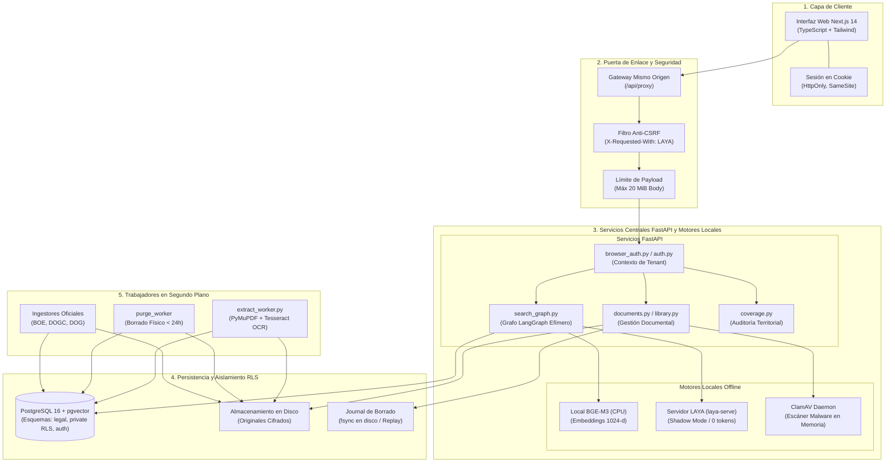

---

## 2. Estructura de Base de Datos (Entity-Relationship Diagrams)

La base de datos utiliza una separación tajante entre el corpus normativo público (esquema `legal`) y los expedientes confidenciales del despacho (esquema `private` con **Row-Level Security** obligatorio). Para optimizar la legibilidad y escala visual, el modelo se desglosa en sus dos dominios fundamentales:

### 2.1 Esquema `legal`: Patrimonio Normativo Público e Índices Vectoriales

Almacena la legislación consolidada del Estado y Comunidades Autónomas, sus gacetas oficiales, versiones temporales y pasajes vectorizados con BGE-M3.

```mermaid
erDiagram
    JURISDICTIONS ||--o{ JURISDICTIONS : "parent_id"
    JURISDICTIONS ||--o{ INSTRUMENTS : "jurisdiction_id"
    JURISDICTIONS ||--o{ COVERAGE : "jurisdiction_id"
    SOURCES ||--o{ COVERAGE : "source_id"
    SOURCES ||--o{ INSTRUMENTS : "source_id"
    SOURCES ||--o{ PUBLICATIONS : "source_id"
    INSTRUMENTS ||--o{ PUBLICATIONS : "instrument_id"
    INSTRUMENTS ||--o{ SECTIONS : "instrument_id"
    SECTIONS ||--o{ SECTION_VERSIONS : "section_id"
    PUBLICATIONS ||--o{ SECTION_VERSIONS : "publication_id"
    SECTION_VERSIONS ||--o{ CHUNKS : "version_id"
    INSTRUMENTS ||--o{ RELATIONSHIPS : "from_instrument"

    JURISDICTIONS {
        text id PK "INE / Identificador Geográfico"
        text level "state / ca / province / municipality"
        text parent_id FK "Jerarquía territorial"
        text name "Nombre oficial y toponimia"
        boolean verified "Cobertura verificada"
    }

    SOURCES {
        text id PK "boe / dogc / dog / ..."
        text name "Nombre del diario oficial"
        text official_url "URL sede electrónica"
        text audit_status "pending / verified"
        jsonb cursor "Puntero de sincronización"
    }

    INSTRUMENTS {
        text id PK "Identificador único de norma"
        text source_id FK "Diario emisor"
        text external_id "Identificador en origen"
        text title "Título oficial publicado"
        text legal_type "Ley Orgánica, RD, Orden..."
        text jurisdiction_id FK "Ámbito territorial"
        text official_reference "Referencia consolidada"
    }

    PUBLICATIONS {
        text id PK "ID de publicación"
        text instrument_id FK "Norma vinculada"
        text source_id FK "Diario oficial"
        date publication_date "Fecha en boletín"
        text sha256 "Hash inmutable del original"
        text object_key "Ruta en disco"
        boolean is_consolidated "Texto consolidado"
    }

    SECTIONS {
        text id PK "ID de sección"
        text instrument_id FK "Norma a la que pertenece"
        text section_key "Clave de artículo"
        text heading "Artículo 1, DT 1ª..."
        integer ordinal "Orden relativo"
    }

    SECTION_VERSIONS {
        text id PK "ID de versión"
        text section_id FK "Sección correspondiente"
        text publication_id FK "Gaceta de publicación"
        date publication_date "Fecha diario oficial"
        date consolidation_date "Fecha consolidación"
        date effective_from "Entrada en vigor certificada"
        date effective_to "Cese de vigencia certificado"
        boolean effectiveness_verified "Prueba documental"
        text text "Texto literal de la norma"
        text language_code "es / ca / gl / eu"
        text sha256 "Hash de integridad"
    }

    CHUNKS {
        text id PK "ID de fragmento"
        text version_id FK "Versión correspondiente"
        integer ordinal "Posición del pasaje"
        integer start_offset "Offset inicial Unicode"
        integer end_offset "Offset final Unicode"
        text passage "Texto del pasaje"
        tsvector search_vector "FTS unaccent simple"
        vector embedding "Vector BGE-M3 (1024-d)"
        text embedding_revision "Revisión fijada modelo"
    }
```

### 2.2 Esquema `private` y `browser_auth`: Expedientes con RLS y Sesiones

Gobernado por **Row-Level Security (RLS)** obligatorio en cada tabla mediante `app.tenant_id` y `app.user_id`. Ningún despacho puede consultar registros de otro tenant bajo ninguna circunstancia.

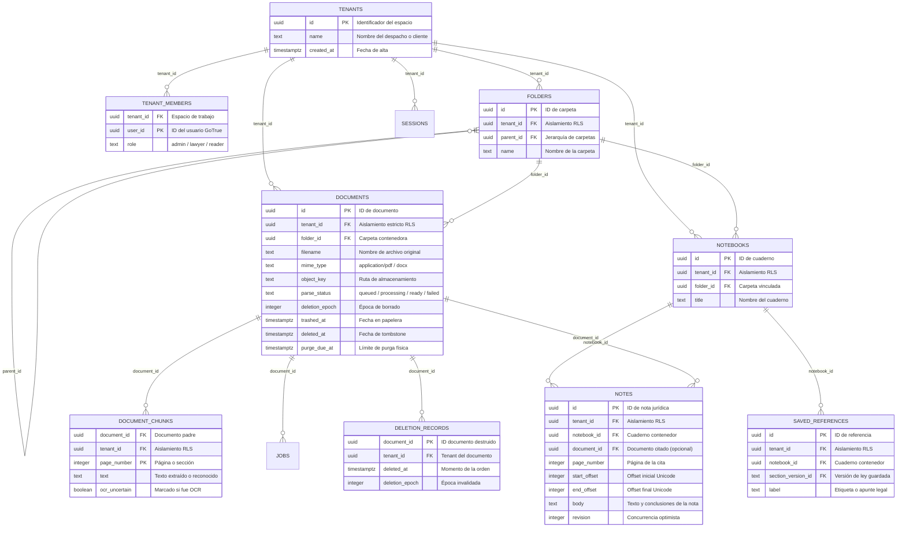

---

## 3. Flujo Detallado de Búsqueda Híbrida y Fusión RRF

La consulta del usuario se procesa mediante **cinco canales de recuperación independientes** ejecutados con timeouts estrictos y planes SQL desacoplados (`force_custom_plan`), unificando los resultados mediante **Reciprocal Rank Fusion (RRF)**.

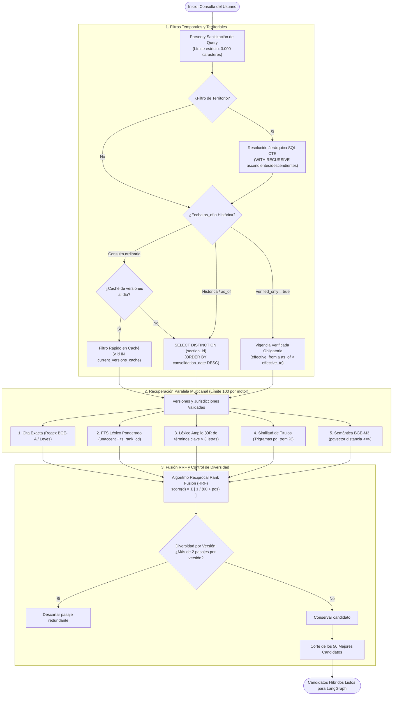

---

## 4. Orquestación del Grafo LangGraph y Clasificador LAYA

El flujo de búsqueda ejecuta un grafo compilado sin persistencia de estado ni checkpoints privados, asegurando que ninguna consulta privada se almacene en disco.

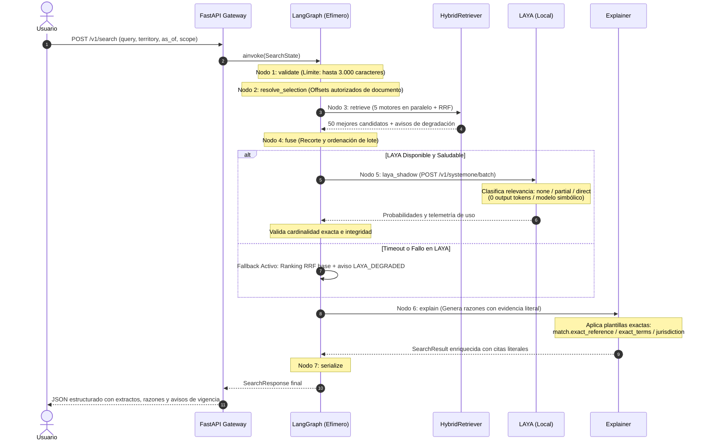

---

## 5. Ciclo de Vida Documental Privado, OCR y Antivirus

La ingestión de documentos privados de clientes (PDF y DOCX) pasa por múltiples barreras de contención antes de estar disponible para búsqueda.

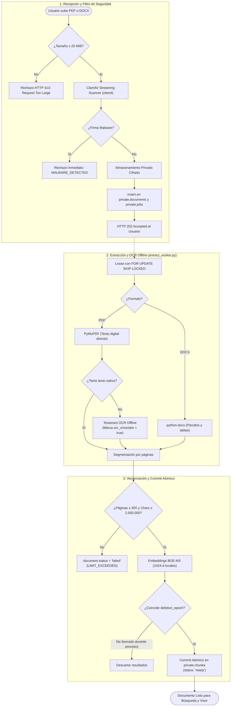

---

## 6. Flujo de Búsqueda Cruzada desde Selección de Texto en Documento

El usuario puede seleccionar cualquier párrafo o cláusula de su contrato o demanda y buscar automáticamente qué normativa oficial estatal o autonómica regula esa materia.

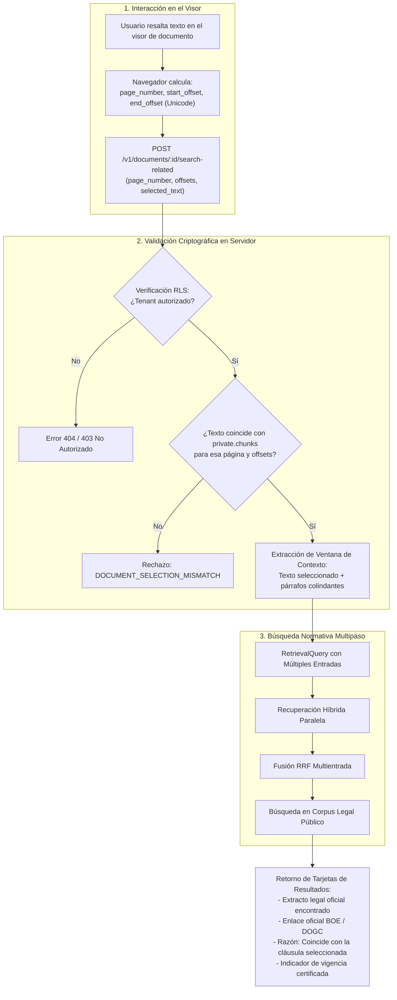

---

## 7. Ciclo de Vida: Papelera vs. Eliminación Permanente y Purga Criptográfica

El sistema distingue tajantemente entre la **Papelera** (estado transitorio recuperable) y la **Eliminación Permanente** (acción irreversible gobernada por auditoría forense y plazos RGPD).

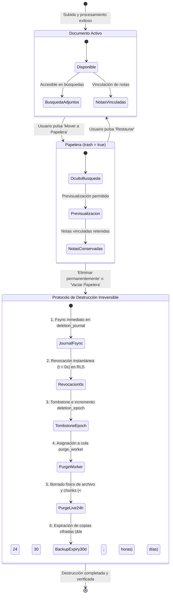

### Protocolo de Restauración de Backups (Disaster Recovery)

Si se restaura una copia de seguridad antigua, el sistema ejecuta de forma obligatoria el script `reapply_deletions.py` contra el journal persistente en disco:

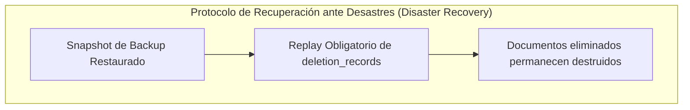

---

## 8. Ingestión de Fuentes Oficiales, Publicaciones y Caché de Versiones

El subsistema de ingesta (`services/ingest/ingest/`) alimenta el corpus legislativo desde fuentes oficiales del Estado y Comunidades Autónomas, preservando la inmutabilidad de los textos originales.

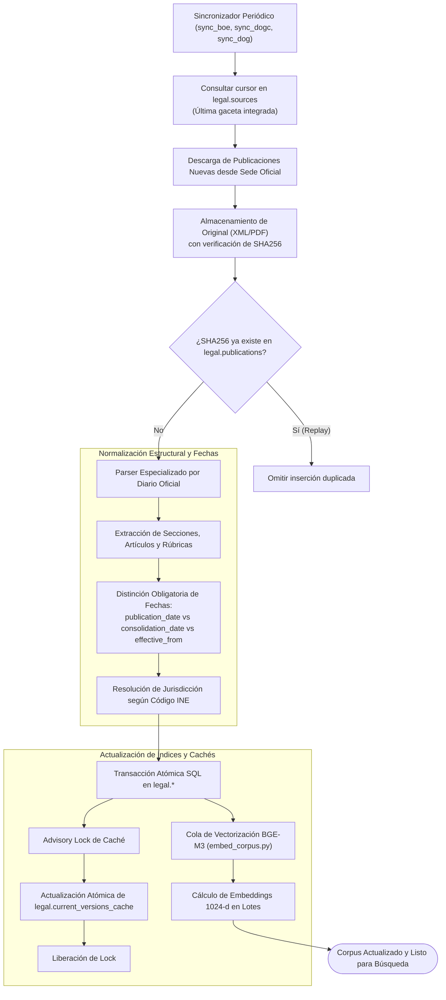

---

## 9. Flujo de Cuadernos Jurídicos, Notas Vinculadas y Referencias Normativas

Permite al equipo legal estructurar su investigación vinculando notas privadas directamente a líneas específicas de documentos o a artículos de leyes.

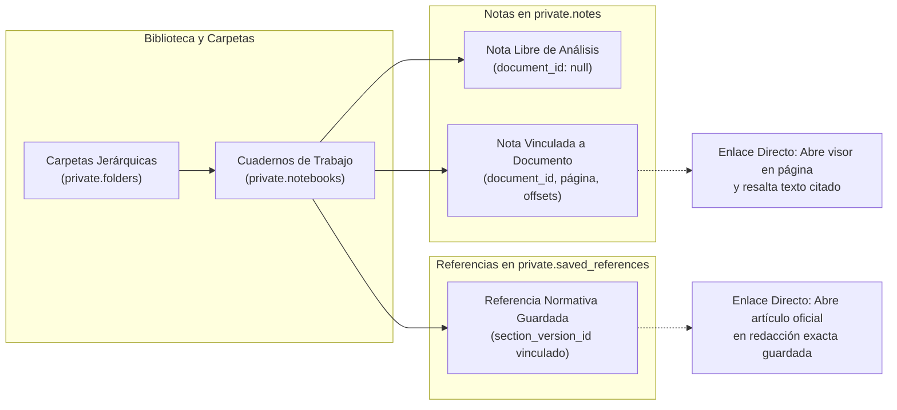

---

## 10. Resumen de Herramientas y Módulos del Sistema

| Herramienta / Módulo | Ubicación en el Código | Función Principal | Garantía Técnica / Restricción Crítica |
|---|---|---|---|
| **API Gateway & Sesión** | `services/api/app/browser_auth.py`, `main.py` | Autenticación basada en cookies HttpOnly y proxy seguro. | Tokens opacos en hash; rechazo CSRF sin `X-Requested-With: LAYA`. |
| **Motor de Búsqueda Híbrido** | `services/api/app/retrieval.py`, `fusion.py` | Recuperación simultánea de 5 motores y combinación RRF. | Planes SQL obligados (`force_custom_plan`); máx 2 pasajes por versión. |
| **Orquestador LangGraph** | `services/api/app/search_graph.py` | Ejecución secuencial de los nodos del pipeline de búsqueda. | Totalmente efímero: sin checkpoints ni persistencia de estado privado. |
| **Clasificador LAYA (Shadow)** | `services/api/app/laya_client.py` | Clasificación simbólica local de relevancia (`none`, `partial`, `direct`). | Cero tokens generados (0 output tokens); fallback transparente si falla. |
| **Embeddings BGE-M3** | `services/api/app/embeddings.py` | Generación de vectores densos multilingües de 1024 dimensiones. | Ejecución 100% offline (`HF_HUB_OFFLINE=1`); revisión fijada validada. |
| **Servicio de Documentos** | `services/api/app/documents.py`, `body_limit.py` | Carga, escaneo de malware y gestión de expedientes privados. | Límite estricto 20 MiB; escaneo ClamAV obligatorio antes de persistir. |
| **Worker de Extracción & OCR** | `services/api/app/extract_worker.py` | Extracción asíncrona de texto digital y OCR local Tesseract. | Ejecución desacoplada de la API; señalización `ocr_uncertain`. |
| **Biblioteca y Cuadernos** | `services/api/app/library.py`, `library_routes.py` | Organización de expedientes en carpetas, notas y referencias. | Control de concurrencia optimista en notas; RLS forzado en cada tabla. |
| **Journal de Eliminaciones** | `services/api/app/deletion_journal.py` | Registro inmutable en disco de órdenes de destrucción irreversible. | Fsync directo; replay mandatorio en cualquier restauración de backup. |
| **Monitor de Cobertura** | `services/api/app/coverage.py`, `scripts/verify_package.py` | Auditoría de fuentes integradas y bloqueo de release nacional. | El sistema rechaza declararse listo si falta cobertura territorial. |
| **Ingestores de Boletines** | `services/ingest/ingest/boe.py`, `dogc.py`, `dog.py` | Ingesta oficial automatizada de fuentes estatales y autonómicas. | Deduplicación por hash SHA256 inmutable; preservación de XML original. |
