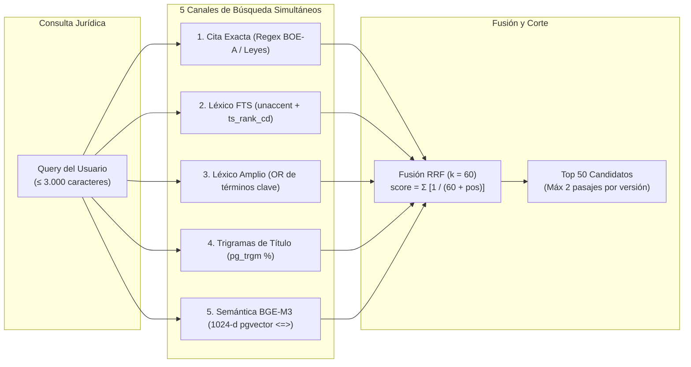
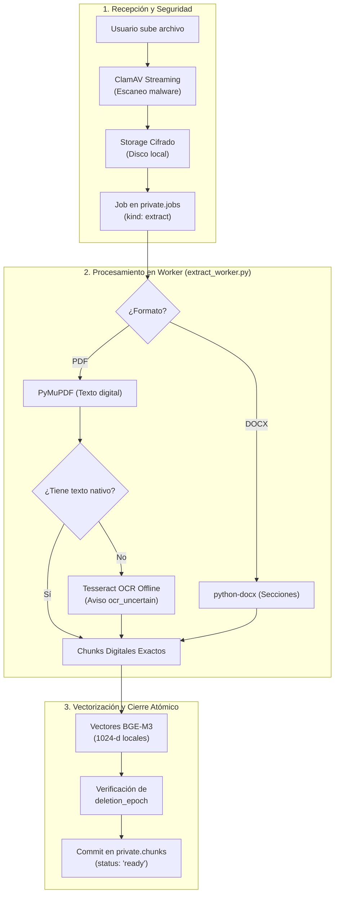
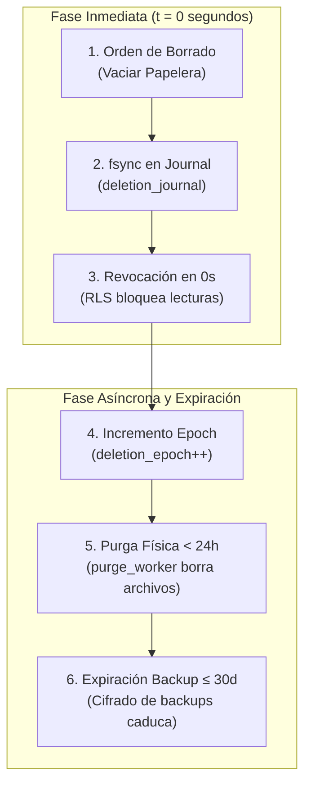

# 📖 LAYA Jurídico — Manual de la Aplicación y Arquitectura del Sistema

> **Codex Jurídico 2026** · Sistema de Búsqueda y Recuperación Normativa Española con Soberanía Local, Cero Modelos Generativos (Zero-LLM), Fusión Híbrida RRF, Clasificación LAYA en Modo Observación y Aislamiento Multi-Tenant Estricto.

<div align="center">

[](https://github.com)
[](https://github.com)
[](https://github.com)
[](https://github.com)
[](https://github.com)
[](https://github.com)

</div>

---

## 🏛️ Prólogo: Principios Fundacionales del Sistema

LAYA Jurídico nace de una exigencia innegociable en el ámbito del derecho: **la precisión literal absoluta y la erradicación total de las alucinaciones**. En el ejercicio jurídico profesional, un artículo inventado, una fecha de vigencia supuesta o un resumen inexacto generado por un modelo de lenguaje (LLM) representan un riesgo procesal inaceptable.

Por ello, esta plataforma opera bajo cinco garantías arquitectónicas fundamentales:

1. **Cero Modelos Generativos (Zero-LLM Policy)**: Ninguna parte del sistema —ni la búsqueda, ni el OCR, ni las explicaciones, ni la reformulación de consultas— utiliza modelos generativos probabilísticos. Las respuestas son **extractos literales de fuentes oficiales** (BOE, DOGC, DOG) y de los documentos subidos por el propio usuario.
2. **Línea Temporal Dual (Publicación vs. Eficacia Jurídica)**: La fecha de publicación de una norma en un boletín oficial **no equivale a su fecha de entrada en vigor**. El sistema prohíbe asumir vigencias no probadas; los estados sin prueba documental independiente se marcan explícitamente como `Vigencia por verificar`.
3. **Privacidad y Aislamiento Forense (Multi-Tenancy y RLS)**: Los documentos privados de cada despacho o cliente se aíslan a nivel de base de datos mediante **PostgreSQL Row-Level Security (RLS)** forzado y claves compuestas `(document_id, tenant_id)`. Los datos privados jamás viajan a servicios de telemetría externos ni se utilizan para entrenar modelos.
4. **Destrucción Física y Criptográfica en Dos Fases**: El sistema separa de manera taxativa la **Papelera** (recuperable indefinidamente) de la **Eliminación Permanente** (revocación inmediata en 0 segundos, purga física en disco en menos de 24 horas y expiración de copias de seguridad cifradas en 30 días con journal de reaplicación obligatoria).
5. **Transparencia Territorial y Honestidad de Cobertura**: Disponer de un catálogo de 8.213 municipios no equivale a tener sus ordenanzas vigentes. El sistema mantiene bloqueado el indicador de lanzamiento nacional hasta que cada nivel territorial (estatal, autonómico, provincial, insular y municipal) cuente con auditoría normativa completa.

---

# 📚 Índice General de la Obra

- [🏛️ Prólogo: Principios Fundacionales del Sistema](#️-prólogo-principios-fundacionales-del-sistema)
- [PARTE I: ACCESO, SESIÓN Y SEGURIDAD DEL ESPACIO DE TRABAJO](#parte-i-acceso-sesión-y-seguridad-del-espacio-de-trabajo)
  - [Capítulo 1: Autenticación y Gestión de Sesiones Seguras](#capítulo-1-autenticación-y-gestión-de-sesiones-seguras)
  - [Capítulo 2: Roles de Usuario y Fronteras de Privacidad](#capítulo-2-roles-de-usuario-y-fronteras-de-privacidad)
- [PARTE II: MOTOR DE BÚSQUEDA JURÍDICA Y RECUPERACIÓN MULTICANAL](#parte-ii-motor-de-búsqueda-jurídica-y-recuperación-multicanal)
  - [Capítulo 3: Modos de Consulta y Ámbitos de Búsqueda](#capítulo-3-modos-de-consulta-y-ámbitos-de-búsqueda)
  - [Capítulo 4: Parámetros Críticos y Filtros Jurídicos](#capítulo-4-parámetros-críticos-y-filtros-jurídicos)
  - [Capítulo 5: El Motor Híbrido de 5 Vías y la Fusión RRF](#capítulo-5-el-motor-híbrido-de-5-vías-y-la-fusión-rrf)
  - [Capítulo 6: Orquestación con LangGraph y Clasificador LAYA](#capítulo-6-orquestación-con-langgraph-y-clasificador-laya)
  - [Capítulo 7: Explicaciones Deterministas y Sellos de Advertencia](#capítulo-7-explicaciones-deterministas-y-sellos-de-advertencia)
- [PARTE III: GESTIÓN DOCUMENTAL PRIVADA Y EXPEDIENTES](#parte-iii-gestión-documental-privada-y-expedientes)
  - [Capítulo 8: Carga, Validación y Escaneo Antivirus](#capítulo-8-carga-validación-y-escaneo-antivirus)
  - [Capítulo 9: Procesamiento Asíncrono y OCR Local Aislado](#capítulo-9-procesamiento-asíncrono-y-ocr-local-aislado)
  - [Capítulo 10: Visor Documental y Búsqueda desde Selección de Texto](#capítulo-10-visor-documental-y-búsqueda-desde-selección-de-texto)
- [PARTE IV: ORGANIZACIÓN DEL CONOCIMIENTO Y NOTAS DE TRABAJO](#parte-iv-organización-del-conocimiento-y-notas-de-trabajo)
  - [Capítulo 11: Estructuración en Carpetas y Biblioteca](#capítulo-11-estructuración-en-carpetas-y-biblioteca)
  - [Capítulo 12: Cuadernos Jurídicos, Citas Exactas y Referencias Normativas](#capítulo-12-cuadernos-jurídicos-citas-exactas-y-referencias-normativas)
- [PARTE V: CICLO DE PRIVACIDAD, PAPELERA Y PROTOCOLO DE PURGA](#parte-v-ciclo-de-privacidad-papelera-y-protocolo-de-purga)
  - [Capítulo 13: La Papelera Recuperable](#capítulo-13-la-papelera-recuperable)
  - [Capítulo 14: Protocolo de Eliminación Permanente y Purga Forense](#capítulo-14-protocolo-de-eliminación-permanente-y-purga-forense)
- [PARTE VI: AUDITORÍA DE FUENTES Y COBERTURA TERRITORIAL](#parte-vi-auditoría-de-fuentes-y-cobertura-territorial)
  - [Capítulo 15: Transparencia del Corpus y Fuentes Oficiales](#capítulo-15-transparencia-del-corpus-y-fuentes-oficiales)
  - [Capítulo 16: Ingesta Inmutable y Reconciliación de Lagunas](#capítulo-16-ingesta-inmutable-y-reconciliación-de-lagunas)
  - [Capítulo 17: Puertas Bloqueantes de Lanzamiento Nacional](#capítulo-17-puertas-bloqueantes-de-lanzamiento-nacional)
- [PARTE VII: SUBDOCUMENTOS DE ARQUITECTURA Y GUÍAS DE OPERACIÓN](#parte-vii-subdocumentos-de-arquitectura-y-guías-de-operación)
  - [Capítulo 18: Mapa de Subdocumentos y Flowcharts Visuales](#capítulo-18-mapa-de-subdocumentos-y-flowcharts-visuales)
  - [Capítulo 19: Comandos de Consola y Operación Local](#capítulo-19-comandos-de-consola-y-operación-local)

---

## PARTE I: ACCESO, SESIÓN Y SEGURIDAD DEL ESPACIO DE TRABAJO

### Capítulo 1: Autenticación y Gestión de Sesiones Seguras

El acceso a la aplicación se realiza a través de `http://127.0.0.1:3000`.

- **Mecanismo de Autenticación**: Basado en una instancia autoalojada de **Supabase Auth / GoTrue** conectada a la base de datos local aislada.
- **Tokens y Cookies**:
  - Las credenciales nunca se almacenan en `localStorage` o `sessionStorage`.
  - El inicio de sesión genera una **cookie `HttpOnly`, `SameSite=Lax` (o `Strict`)**, protegida contra accesos desde JavaScript del navegador.
  - El token de sesión en la base de datos es un hash criptográfico opaco almacenado en la tabla `browser_auth.sessions`.
- **Protección contra CSRF**:
  - Todas las mutaciones HTTP (POST, DELETE) y solicitudes autenticadas requieren la cabecera obligatoria `X-Requested-With: LAYA` y validación estricta de origen (`Origin` / `Referer`). Cualquier solicitud sin este encabezado es rechazada con `CSRF_REJECTED`.
- **Expiración y Revocación**:
  - Las sesiones expiran por inactividad tras 1 hora.
  - Al hacer clic en **Cerrar sesión**, el token se purga de la base de datos y la cookie queda invalidada de forma inmediata.
  - El cambio de contraseña revoca todas las sesiones activas asociadas al usuario en todos los dispositivos.

### Capítulo 2: Roles de Usuario y Fronteras de Privacidad

El sistema aplica tres roles estrictos dentro de cada espacio de trabajo (`tenant`):

| Rol | Capacidades | Restricciones Inviolables |
|---|---|---|
| **`admin`** | Gestión total de documentos, carpetas, cuadernos, usuarios del espacio y vaciado de papelera. | No puede saltarse las políticas RLS ni acceder a datos de otros tenants. |
| **`lawyer`** | Búsqueda normativa, subida de documentos, creación de carpetas, cuadernos y notas jurídicas. | No puede alterar la configuración del tenant ni las asignaciones de otros miembros. |
| **`reader`** | Lectura y consulta de documentos autorizados, cuadernos y ejecución de búsquedas. | **Modo de solo lectura**: botones de subida, edición, traslado a papelera o borrado deshabilitados. |

**Invariante de Aislamiento**: El identificador de cliente (`X-Tenant-ID`) es meramente un selector de contexto; **la autorización se calcula siempre en el servidor** mediante la pertenencia verificada del usuario en `private.tenant_members`.

---

## PARTE II: MOTOR DE BÚSQUEDA JURÍDICA Y RECUPERACIÓN MULTICANAL

### Capítulo 3: Modos de Consulta y Ámbitos de Búsqueda

En la pantalla principal de búsqueda (`/`), el usuario dispone de tres ámbitos operativos:

1. **Normativa (Ámbito por defecto)**:
   - Recupera disposiciones generales, leyes orgánicas, reales decretos, órdenes ministeriales y ordenanzas que integran el ordenamiento jurídico positivo.
   - Excluye expresamente anuncios oficiales, nombramientos, licitaciones o actos administrativos de trámite.
2. **Todas las publicaciones**:
   - Amplía la búsqueda para incluir el catálogo completo de diarios oficiales (secciones de notificaciones, anuncios y boletines informativos).
   - Los resultados de este ámbito se etiquetan visualmente como tales para evitar que un acto particular sea interpretado como una norma de general aplicación.
3. **Documentos adjuntos**:
   - Restringe la búsqueda exclusivamente a los expedientes privados (PDF y DOCX) subidos y procesados por el propio despacho en la biblioteca.
   - Permite consultar simultáneamente múltiples contratos o resoluciones privadas bajo el mismo criterio conceptual.

### Capítulo 4: Parámetros Críticos y Filtros Jurídicos

Para garantizar que los resultados respondan a la realidad jurídica de un caso concreto, la aplicación evalúa cuatro filtros avanzados:

- **Ámbito Territorial Jerárquico**:
  - Permite seleccionar España completa o descender a Comunidades Autónomas, Provincias o Municipios específicos.
  - **Resolución Recursiva**: El motor SQL ejecuta una consulta jerárquica con Common Table Expression (`WITH RECURSIVE` sobre `legal.jurisdictions`) que recupera tanto la normativa propia de la entidad como la de todos sus ascendientes territoriales (por ejemplo, al buscar en *Barcelona*, incluye la normativa municipal de Barcelona, la autonómica de Cataluña y la estatal de España).
- **Fecha de Consulta (`as_of`) y Redacciones Históricas**:
  - Permite situar el análisis legal en un momento pretérito exacto (p. ej., *«qué redacción del Código Civil aplicaba el 14 de marzo de 2020»*).
  - La casilla **Incluir versiones históricas** permite recuperar redacciones derogadas o modificadas. Si está desmarcada, el sistema selecciona únicamente la redacción vigente más reciente anterior o igual a la fecha de corte.
- **Filtro Estricto de Vigencia Verificada (`verified_only`)**:
  - Excluye de los resultados cualquier artículo o disposición cuya entrada en vigor no haya sido certificada documentalmente en el sistema.
  - **Aviso**: Si una norma no tiene prueba de vigencia cargada, este filtro la omitirá deliberadamente antes que mostrar una vigencia incierta.
- **Refinamiento de Consulta (Cuestión Jurídica y Objetivo)**:
  - Permite desglosar la consulta en:
    - *Problema jurídico*: Hechos y marco material (hasta 1.000 caracteres).
    - *Objetivo de la consulta*: Pretensión o efecto procesal buscado (hasta 1.000 caracteres).
  - No se infieren hechos no aportados por el usuario.

### Capítulo 5: El Motor Híbrido de 5 Vías y la Fusión RRF

Para maximizar el recall (exhaustividad) y la precisión sin depender de un único algoritmo, el recuperador `HybridRetriever` dispara **cinco canales simultáneos** de búsqueda:



1. **Canal de Cita Exacta**: Detecta patrones regulares como `BOE-A-1994-26003`, `Ley 29/1994` o `artículo 24`. Si existe coincidencia exacta, se inyecta directamente con máxima prioridad.
2. **Canal Léxico FTS (`websearch_to_tsquery`)**: Búsqueda textual completa sobre el diccionario `simple` en PostgreSQL tras aplicar la función `unaccent()` para normalizar tildes y diacríticos. Pondera con `ts_rank_cd`.
3. **Canal Léxico Amplio**: Extrae palabras jurídicas clave de más de 3 letras unidas por operadores `OR` para capturar normas que utilicen sinónimos o variantes morfológicas.
4. **Canal de Trigramas de Título (`pg_trgm`)**: Emplea el operador `%` para tolerar erratas tipográficas y variaciones en la rúbrica oficial de la ley.
5. **Canal Semántico Denso (BGE-M3 + `pgvector`)**:
   - Genera un vector denso de **1024 dimensiones** usando el modelo local `BAAI/bge-m3` ejecutado de manera 100% offline.
   - Ejecuta la búsqueda de similitud mediante la distancia coseno (`<=>`) en `pgvector`.
   - **Planes SQL Forzados**: Aplica `SET LOCAL plan_cache_mode = 'force_custom_plan'` para evitar que el planificador genérico de PostgreSQL degrade el rendimiento sobre tablas con millones de pasajes.

**Fusión por Rango Recíproco (RRF)**:
Los cinco resultados se combinan mediante la fórmula matemática:
$$\text{RRF Score}(d) = \sum_{m \in \text{Motores}} \frac{1}{60 + \text{Posición}_m(d)}$$

**Regla de Diversidad**: Ninguna versión de artículo puede acaparar la lista de resultados; se limita a un **máximo de 2 pasajes por versión** de sección, recortando la salida final a los **50 candidatos más relevantes**.

### Capítulo 6: Orquestación con LangGraph y Clasificador LAYA

El flujo de búsqueda se ejecuta mediante un grafo de estados `StateGraph` compilado con **LangGraph Core**, asegurando un ciclo de vida libre de efectos secundarios:

1. **`validate`**: Verifica los presupuestos de longitud de la consulta (máximo 3.000 caracteres).
2. **`resolve_selection`**: Resuelve los offsets de texto si la búsqueda proviene de un documento privado.
3. **`retrieve`**: Invoca el `HybridRetriever` y captura los candidatos.
4. **`fuse`**: Aplica los límites de cardinalidad del lote.
5. **`laya_shadow` (Clasificador Simbólico LAYA en Modo Observación)**:
   - Se comunica localmente mediante HTTP con el proceso `laya[serve]` en `http://127.0.0.1:8001/v1/systemone/batch`.
   - Evalúa cada candidato con la pregunta temática de clasificación: *`relevance`* (`none` / `partial` / `direct`).
   - **Invariante Cero-Generación**: El modelo tiene prohibido generar texto; si el campo `output_tokens` es distinto de 0, la respuesta es rechazada.
   - **Circuit Breaker**: Si el servicio LAYA se satura o supera el tiempo límite, el disyuntor se abre y el sistema entra en **degradación controlada**, devolviendo el ranking base de RRF acompañado de la advertencia `LAYA_DEGRADED`.
6. **`explain`**: Construye las explicaciones deterministas basadas en evidencia.
7. **`serialize`**: Emite la respuesta final sin persistir grafos en base de datos.

### Capítulo 7: Explicaciones Deterministas y Sellos de Advertencia

En cumplimiento de la política de cero alucinación, **cada tarjeta de resultado explica exactamente por qué ha sido seleccionada** utilizando plantillas basadas en evidencia empírica:

| Código de Razón | Texto Visible al Usuario | Evidencia Comprobada |
|---|---|---|
| `match.exact_reference` | *"Coincide con la referencia legal indicada en la búsqueda: {referencia}"* | Coincidencia en el identificador oficial de la ley. |
| `match.exact_terms` | *"El artículo contiene las expresiones: {términos}"* | Coincidencia literal de términos en el cuerpo del artículo. |
| `match.selected_clause` | *"Este artículo comparte conceptos con el fragmento seleccionado en tu documento"* | Cruce conceptual entre el fragmento de PDF/DOCX y la ley. |
| `match.same_jurisdiction` | *"La norma corresponde al ámbito territorial seleccionado: {territorio}"* | Validación jerárquica INE del territorio. |
| `match.historical` | *"Se muestra la redacción con fecha de publicación {fecha}; comprueba su vigencia efectiva"* | Redacción histórica no consolidada. |

> [!WARNING]
> **Texto consolidado informativo**: El texto consolidado del BOE tiene valor divulgativo y no fehaciente; la única redacción auténtica es la publicada en los diarios oficiales originarios.

> [!WARNING]
> **Vigencia por verificar**: Indica que el intervalo de vigencia efectiva no ha sido contrastado con prueba documental independiente.

> [!NOTE]
> **Cobertura nacional pendiente**: Recuerda que el corpus autonómico o local puede estar incompleto hasta culminar la integración de todas las fuentes territoriales.

---

## PARTE III: GESTIÓN DOCUMENTAL PRIVADA Y EXPEDIENTES

### Capítulo 8: Carga, Validación y Escaneo Antivirus

En la sección **Documentos** (`/documents`), el usuario puede cargar expedientes procesales, contratos, demandas o escrituras:

- **Formatos Admitidos**: Exclusivamente **PDF** (`application/pdf`) y **DOCX** (`application/vnd.openxmlformats-officedocument.wordprocessingml.document`).
- **Límites de Seguridad Físicos**:
  - Tamaño máximo de archivo: **20 MiB** (controlado en streaming por `BodyLimitMiddleware`).
  - Máximo de páginas: **300 páginas** por documento.
  - Máximo de caracteres extraídos: **2.000.000 caracteres**.
  - Rechazo de archivos ZIP con relaciones externas inseguras o macros sospechosas.
- **Escaneo Antivirus Obligatorio con ClamAV**:
  - Antes de escribir el archivo en el almacenamiento permanente, el flujo de bytes se envía al socket de **ClamAV**.
  - Si se detecta cualquier firma vírica, el archivo se destruye en memoria inmediatamente y se devuelve el error `MALWARE_DETECTED`.

### Capítulo 9: Procesamiento Asíncrono y OCR Local Aislado

El procesamiento se desacopla de la API principal a través del trabajador en segundo plano `extract_worker.py`:



- **Documentos PDF**: Se procesan inicialmente con **PyMuPDF (`fitz`)**, preservando la geometría y los números de página originales.
- **Detección de PDF Escaneado y OCR Local**:
  - Si una página carece de texto digital, se activa el motor de **Tesseract OCR** local con un presupuesto de renderizado controlado.
  - Los fragmentos reconocidos mediante OCR se marcan en la base de datos con el campo `ocr_uncertain = true`, mostrando una advertencia visible en la interfaz para que el letrado verifique el documento original.
- **Documentos DOCX**: Se extraen los párrafos y tablas mediante `python-docx`. Dado que los archivos DOCX no poseen una paginación fija nativa, se estructuran en **secciones lógicas numeradas**.

### Capítulo 10: Visor Documental y Búsqueda desde Selección de Texto

Al abrir cualquier documento procesado (`/documents/[id]`):

1. **Visor Integrado**: Permite hojear el documento página por página y previsualizar el PDF original.
2. **Selección de Texto en Pantalla**: El usuario puede resaltar cualquier cláusula, hecho o párrafo.
3. **Verificación de Integridad de la Selección**:
   - Al pulsar **«Buscar normativa relacionada»**, el navegador envía la página, el texto seleccionado y los offsets Unicode (`start_offset` y `end_offset`).
   - El backend **comprueba criptográficamente contra `private.chunks`** que el texto enviado coincida exactamente con los bytes almacenados en esa posición. Cualquier manipulación indebida es rechazada con `DOCUMENT_SELECTION_MISMATCH`.
4. **Búsqueda Normativa Cruzada**:
   - El sistema extrae el fragmento seleccionado junto con su contexto colindante inmediato (hasta 3 pasajes).
   - Ejecuta una búsqueda híbrida contra todo el corpus legislativo oficial y devuelve los artículos del BOE o diarios autonómicos directamente aplicables a esa cláusula del contrato.

---

## PARTE IV: ORGANIZACIÓN DEL CONOCIMIENTO Y NOTAS DE TRABAJO

### Capítulo 11: Estructuración en Carpetas y Biblioteca

La biblioteca documental (`DocumentLibrary`) permite ordenar los expedientes mediante una jerarquía de carpetas anidadas (`private.folders`), facilitando la separación por clientes, procedimientos o áreas de práctica jurídica.

- Los documentos pueden moverse de carpeta en cualquier momento sin alterar sus hashes de integridad ni sus notas vinculadas.
- Todas las consultas a la biblioteca están gobernadas por RLS: un usuario solo puede visualizar las carpetas del espacio de trabajo al que pertenece.

### Capítulo 12: Cuadernos Jurídicos, Citas Exactas y Referencias Normativas

La sección **Cuadernos** (`/notebooks`) proporciona un entorno de trabajo colaborativo para el análisis de casos:

- **Estructura de Cuaderno (`private.notebooks`)**: Agrupa las conclusiones y la estrategia jurídica de un expediente.
- **Notas Ancladas a Documentos Privados (`private.notes`)**:
  - Una nota puede asociarse a un documento completo o a un **pasaje exacto** (página, `start_offset` y `end_offset`).
  - Al consultar la nota en el cuaderno, un enlace interactivo permite saltar directamente a la página del documento y ver el texto subrayado.
  - Cuenta con control de concurrencia optimista (`revision`) para evitar que dos letrados sobreescriban notas simultáneamente.
- **Referencias Normativas Guardadas (`private.saved_references`)**:
  - Permite anclar artículos de leyes concretos (`section_version_id`) dentro del cuaderno.
  - Al pulsar sobre la referencia, se abre el visor normativo oficial mostrando el artículo en la redacción exacta guardada.

---

## PARTE V: CICLO DE PRIVACIDAD, PAPELERA Y PROTOCOLO DE PURGA

### Capítulo 13: La Papelera Recuperable

Cuando un usuario elige **Mover a Papelera**:

- El documento actualiza su campo `trashed_at = now()`.
- **Desaparición de Búsquedas Activas**: El documento deja de aparecer en la biblioteca ordinaria y queda excluido del modo de búsqueda de adjuntos.
- **Retención Segura**: El archivo original y todas sus notas vinculadas se conservan íntegramente.
- **Recuperabilidad Total**: El usuario puede entrar en `/trash`, inspeccionar el documento y pulsar **Restaurar** en cualquier momento sin pérdida de datos.

### Capítulo 14: Protocolo de Eliminación Permanente y Purga Forense

La eliminación permanente (mediante el botón individual o la acción **Vaciar Papelera**) es una operación destructiva irreversible gobernada por un estricto protocolo de seis fases:



1. **Fsync en Journal Independiente**: Antes de confirmar la transacción a la base de datos, se escribe y fuerza la sincronización en disco (`fsync`) del registro de borrado en `deletion_journal.jsonl`.
2. **Revocación Inmediata de Acceso (t = 0 s)**: Se aplica un tombstone en la base de datos (`deleted_at = now()`). Desde ese milisegundo, cualquier intento de lectura o descarga a través de la API es bloqueado por las políticas RLS.
3. **Incremento de `deletion_epoch`**: Invalida cualquier trabajo asíncrono de extracción que estuviera en ejecución, impidiendo que datos en memoria vuelvan a escribirse en la base de datos.
4. **Purga Física en Vivo (&lt; 24 horas)**: El trabajador `purge_worker` elimina físicamente los archivos binarios del sistema de archivos y purga las filas de texto y vectores de `private.chunks` y `private.documents`.
5. **Caducidad de Copias de Seguridad Cifradas (&le; 30 días)**: Las copias de seguridad se cifran con claves rotativas y tienen una vida útil máxima de 30 días, tras la cual las copias antiguas se destruyen de forma criptográfica.
6. **Barrera de Replicación en Restauración (`reapply_deletions.py`)**: Si por una contingencia técnica se restaurase una copia de seguridad antigua, el procedimiento de restauración ejecuta obligatoriamente el script de reaplicación del journal, eliminando de inmediato cualquier documento que hubiera sido borrado con posterioridad a la creación de la copia.

---

## PARTE VI: AUDITORÍA DE FUENTES Y COBERTURA TERRITORIAL

### Capítulo 15: Transparencia del Corpus y Fuentes Oficiales

La vista **Cobertura** (`/coverage`) detalla el inventario empírico del sistema:

- **Métricas Observadas**: Número de jurisdicciones inventariadas, normas registradas, versiones de artículos y fuentes sincronizadas.
- **Fuentes Integradas**:
  - **BOE (Boletín Oficial del Estado)**: Legislación estatal consolidada y publicaciones del diario oficial.
  - **DOGC (Diari Oficial de la Generalitat de Catalunya)**: Normativa autonómica catalana con preservación de doble URL lingüística oficial.
  - **DOG (Diario Oficial de Galicia)**: Normativa autonómica gallega con selección conservadora de disposiciones generales.
- **Enlace a la Fuente Oficial**: Cada extracto y versión cuenta con un botón directo para abrir el texto publicado en la sede electrónica oficial del diario correspondiente.

### Capítulo 16: Ingesta Inmutable y Reconciliación de Lagunas

El subsistema de ingesta (`services/ingest/ingest/`) no altera los documentos originales:

- **Almacenamiento de Originales con SHA256**: Cada publicación se descarga de la sede oficial y se almacena con su hash criptográfico SHA256 inmutable.
- **Detección de Replays**: Si una publicación descargada tiene un hash idéntico al ya almacenado, se omite su inserción, evitando la duplicación de datos.
- **Reconciliación de Brechas**: Scripts especializados (`reconcile_boe_gaps.py`, `reconcile_dogc_gaps.py`) auditan la secuencia de gacetas publicadas e identifican cualquier número faltante para su recuperación automática.

### Capítulo 17: Puertas Bloqueantes de Lanzamiento Nacional

El sistema cuenta con un mecanismo de auditoría técnica que **bloquea formalmente la declaración de preparación para producción** (`scripts/verify_package.py --release`):

- **Bloqueadores Activos**:
  - `NATIONAL_AUDIT_PENDING`: Faltan por incorporar las ordenanzas y boletines de miles de municipios y diputaciones forales/insulares.
  - `PROFESSIONAL_EVALUATION_PENDING`: El banco de 200 casos de prueba debe ser revisado y firmado por abogados independientes en los cuatro idiomas oficiales (castellano, catalán, gallego y euskera).
  - `OPERATIONS_REHEARSAL_PENDING`: Custodia independiente de claves criptográficas de backup y replicación externa del journal de borrado.

---

## PARTE VII: SUBDOCUMENTOS DE ARQUITECTURA Y GUÍAS DE OPERACIÓN

### Capítulo 18: Mapa de Subdocumentos y Flowcharts Visuales

Para profundizar en el diseño técnico, el repositorio incluye documentación especializada:

- **[Diagramas de Flujo y Estructura Técnica](LAYA_Juridico_Codex_2026/docs/ESTRUCTURA_Y_FLOWCHARTS.md)**: Contiene los diagramas Mermaid con la arquitectura de red, el modelo entidad-relación, el pipeline de 5 motores RRF, el ciclo de vida de la papelera y la ingesta.
- **[Guía de Usuario](LAYA_Juridico_Codex_2026/docs/APP_GUIDE.md)**: Manual funcional para letrados y personal del despacho.
- **[Guía de Operador](LAYA_Juridico_Codex_2026/docs/OPERATOR_GUIDE.md)**: Arranque de servicios, certificados TLS, escáner antivirus y copias de seguridad.
- **[Guía de Desarrollador](LAYA_Juridico_Codex_2026/docs/DEVELOPER_GUIDE.md)**: Convenciones de código, pruebas con pytest y límites de arquitectura.
- **[Referencia de Código Propio](LAYA_Juridico_Codex_2026/docs/CODE_REFERENCE.md)**: Inventario detallado de cada archivo, función y clase del proyecto.
- **[Ampliación de Fuentes](LAYA_Juridico_Codex_2026/docs/SOURCE_EXTENSION.md)**: Cómo escribir adaptadores para nuevos boletines autonómicos o provinciales.

### Capítulo 19: Comandos de Consola y Operación Local

Ejecutar desde el directorio `LAYA_Juridico_Codex_2026` en PowerShell:

```powershell
# Estado del stack de servicios locales (FastAPI, Postgres, LAYA, ClamAV)
.venv/Scripts/python.exe scripts/local_stack.py status

# Iniciar todos los servicios supervisados
.venv/Scripts/python.exe scripts/local_stack.py start

# Detener los servicios conservando volúmenes de datos
.venv/Scripts/python.exe scripts/local_stack.py stop

# Generar informe de métricas del entorno en ejecución
.venv/Scripts/python.exe scripts/runtime_report.py

# Verificación de integridad del paquete (modo desarrollo)
.venv/Scripts/python.exe scripts/verify_package.py

# Verificación de puertas de lanzamiento nacional (falla por diseño hasta completar cobertura)
.venv/Scripts/python.exe scripts/verify_package.py --release
```

---

*LAYA Jurídico — Diseñado y auditado bajo estándares de máxima rigurosidad técnica y jurídica.*
